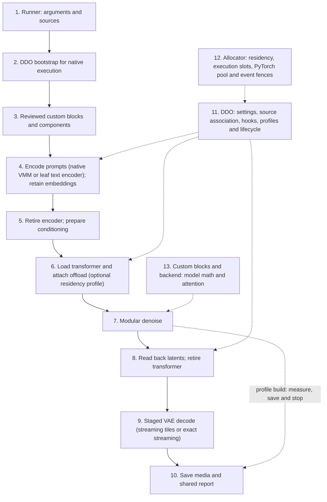

# Runner architecture

Each `scripts/<model>/` entry owns visible argument parsing and staged Modular
Diffusers calls. Minimal examples deliberately show complete essential integration,
rather than hiding generation behind a mode dispatcher.

## End-to-end flow

Conventional full-pipeline controls expose fewer phase boundaries than staged
runners.

## Diagram guide

Boxes 1–10 describe the staged runner flow. Boxes 11–13 identify supporting
owners, not additional generation stages. Native bootstrap applies only when
the selected route requires it.

1. **Arguments and sources.** The runner parses model inputs, preset/backend,
   generation settings and component-source locations.
2. **Native bootstrap.** When required, DDO relaunches the command in a fresh
   child and installs the allocator before CUDA-owning imports.
3. **Custom blocks and components.** Loads trusted model-specific modular code
   and the components needed for the current phase. Each independent custom-block
   repository owns its component classes and modular state.
4. **Prompt encoding.** Produces the conditioning embeddings needed by denoise
   without retaining unnecessary encoder outputs. In the LTX video VMM entries on
   `vmm/auto`, the Gemma text encoder defaults to DDO's native VMM component
   route (4 GiB encoder ceiling, `--no-text-encoder-native-vmm` restores leaf);
   other routes use Diffusers leaf group offload. Shared helper:
   `scripts/helpers/ltx2/text_encoder.py`.
5. **Conditioning preparation.** Retires the encoder and prepares connectors,
   image or audio conditioning where the model requires them. Avoid keeping
   duplicate weights, embeddings or connector intermediates.
6. **Transformer setup.** Loads the transformer and asks DDO to apply its selected
   offload policy; the runner does not implement allocator scheduling. Use the
   execution device to place computation, even when weights remain on CPU. With
   `--ddo-profile NAME|auto` on `vmm/auto`, DDO applies a saved VMM residency
   budget; `auto` names the profile from resolution, frames and the
   activation-relevant options (`scripts/helpers/ltx2/vmm_profile.py`), because
   DDO does not infer the workload shape.
7. **Modular denoise.** Executes the model's modular schedule and forward calls,
   using the prepared conditioning and selected offload route. The VMM entries
   wrap it in `profile_run()`; with `--build-ddo-profile` (run twice with
   `--steps 3`: floor, then hardware ceiling) DDO measures this region, saves the
   result and the runner stops before decode.
8. **Transformer retirement.** Reads back the required latents and releases
   transformer references after the required CUDA work completes. A host callback
   returning does not prove GPU completion, and unloading a component does not
   permit force-freeing cached allocations.
9. **VAE decode.** Loads and executes the decoder with the selected device and
   supported tiling/streaming strategy. Video/audio decoding can have separate
   stages. Video temporal streaming and image spatial tiling are different
   algorithms, not allocator policies. `--video-decoder exact-streaming` selects
   the exact temporal streaming decoder of the custom blocks (stateful
   non-causal temporal convolutions that pad only at the true sequence ends,
   validated against the whole-sequence decoder); the default `streaming-tiles`
   is unchanged.
10. **Media and reports.** Saves generated output and uses the shared RunTracker
    (`scripts/helpers/inference_utils.py`) to combine host phase/step and memory
    measurements with public DDO reports.
11. **DDO.** Owns generic configuration, source association, hooks, fallback,
    cleanup, residency profiles (measurement, identity, storage) and public
    metrics; these responsibilities are not duplicated in runners or shared
    helpers.
12. **Native allocator.** For native routes, owns arena backing, residency,
    execution slots, the process PyTorch allocator pool (segmented owners,
    growable shared owner, idle cache) and CUDA events within configured limits.
    Sources, buffers and GPU backing can be reused only after the work using them
    has completed.
13. **Model blocks and backend.** Own model mathematics, attention and quantized
    operators; DDO transport does not replace those forwards. Model-specific
    math, such as LTX optimizations and the `--video-self-attention` backends
    (including SDPA with cuDNN priority), stays outside generic shared helpers.

The dotted arrow from 7 to 10 is the profile build path: it saves the run
report without decoding.

See [DDO runtime architecture](https://github.com/DEVAIEXP/diffusers-dynamic-offloader/blob/main/docs/developer/architecture.md)
for the other side of the integration boundary,
[diagnostics](diagnostics.md) for timing and cleanup semantics, and
[interface compatibility](runner-interface.md) for supported older commands.
