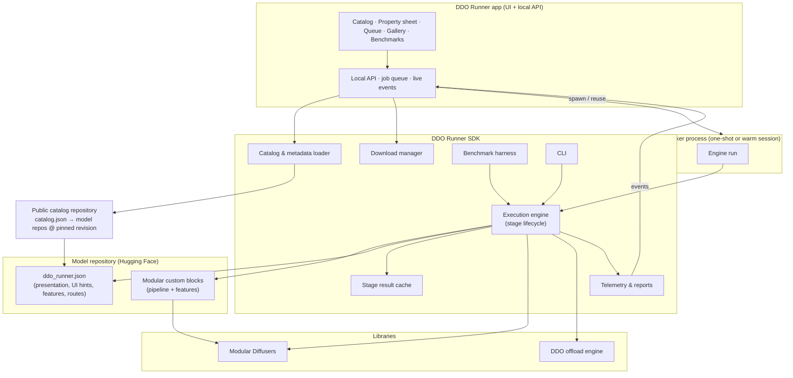
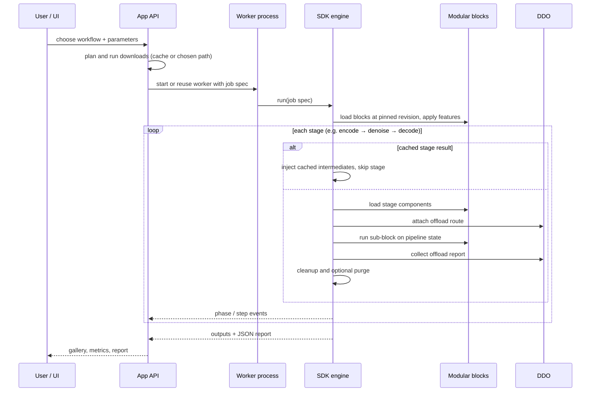

# DDO Runner — project proposal

*Draft for discussion with the Diffusers team — 2026-11-25*

> **Status:** proposal. DDO Runner has not been built yet. This document describes the problem it is
> meant to solve and the architecture we plan to implement. DDO, the offload engine it would use, already
> exists and is validated on selected workloads.

## Summary

DDO Runner is a proposed open-source runner and interface for **Modular Diffusers** workflows. It would let
a user pick a workflow from a catalog, adjust its parameters in a generated property sheet and run it
locally on consumer GPUs. It would use **DDO (Diffusers Dynamic Offloader)** as the memory/offload engine.

The core idea is simple: **the model lives in a Modular custom-blocks repository; everything else is
generic.** Model developers would keep writing standard Modular blocks. DDO Runner is designed to add no
new programming model on top of Modular. It would read what the blocks already declare, add a small
metadata file for presentation, and run any conforming repository through one standardized execution
engine.

Unlike tools that call a whole pipeline at once, DDO Runner is designed to execute a workflow **stage by
stage**. Each stage would have its own components, offload route, measurements and live events. This is
what would make a flexible interface, per-component memory management and comparable benchmarks possible.

## Motivation

Today, running a new model with memory-aware offloading usually means writing a dedicated runner script
per model and per mode. In our own test lab this grew to many hand-written runners. Each one had its own
phase structure, console output, metrics and argument parsing. That approach does not scale:

- Every new model needs a new script, and every script needs maintenance.
- Metrics and benchmarks are not comparable across models, because each runner measures differently.
- Users need to read code and CLI flags to use a model; there is no consistent interface.
- Projects that centralize per-model pipeline code tend to accumulate endless model-specific maintenance.

That last point drives the architecture. When a single application owns the pipelines of every model,
every model-specific bug, quality regression, missing feature and checkpoint change becomes an issue in
that one repository. The issue tracker grows faster than a small team can answer it, and the project
slows down for everyone.

DDO Runner is designed to avoid this through **clear ownership boundaries**:

- **Model problems belong to the model repository.** Model math, components, features and checkpoints
  would live in each custom-blocks repository and be maintained there by whoever publishes the model. A
  model issue would be reported and fixed where the model lives.
- **The SDK and the app would only own generic behavior.** They would cover the execution lifecycle,
  offload attachment, telemetry, catalog, downloads and interface. With no model-specific code, they would
  never take on problems that are not theirs.
- **Offload problems belong to DDO.** Memory and offload behavior would be handled by the offload engine
  through its public contract, not patched per model in the runner.
- **Contracts make the boundary checkable.** Each model repository would ship a metadata file and a CPU
  conformance check. The catalog would distinguish verified workflows from community ones, so users know
  who maintains what and where to report issues.

The goal is that adding a model does not add maintenance to the application, which stays small and stable
while the catalog grows.

Modular Diffusers already solves the hardest part: composable, shareable pipeline blocks with declared
inputs, outputs and components. DDO Runner is meant to build on that instead of duplicating it.

## Goals

1. **One engine for every conforming workflow.** No per-model runner scripts. A custom-blocks repository
   plus a metadata file should be enough to run, benchmark and expose a model in the UI.
2. **Model code stays with the model.** Model math, components and model-specific features (for example
   ControlNet, IP-Adapter, LoRA) live in the model's custom-blocks repository as Modular blocks. The SDK
   and the app never contain model-specific branches.
3. **Derive, don't redeclare.** Stages, components, parameters and outputs are derived from Modular
   declarations (`sub_blocks`, `expected_components`, `inputs`, `intermediate_outputs`). The metadata
   file only adds what Modular does not describe: presentation, UI hints, feature descriptions and
   offload routes.
4. **Standardized execution and telemetry.** Every stage follows the same lifecycle, emits the same phase
   names and the same indicators (wall time, peak RAM/VRAM with explicit delta/absolute scope, per-step
   timing, per-component offload reports), so benchmarks become comparable across models.
5. **A modern, flexible local interface.** A catalog of workflows with previews, a dynamic property sheet
   generated from the workflow's declarations, a job queue with live progress, galleries and a
   benchmark view, targeting Windows, Linux and WSL.
6. **Headless first.** Every operation (validate, download, run, benchmark) is an SDK/CLI operation. The UI
   is only a client, so everything stays scriptable, debuggable and testable without it.
7. **Contribute upstream.** Where Modular has gaps, improve them in small, upstream-ready steps and
   propose them to Diffusers rather than forking.

## What DDO Runner is designed to add beyond running a pipeline

Running a pipeline from a single call with a set of keyword arguments is useful, but it treats the
pipeline as one opaque unit. An interface and a memory-aware engine need more control than that. DDO
Runner is designed around that difference:

| Planned capability | What it would mean in practice |
|---|---|
| **Stage-level execution, not one coupled call** | Each top-level stage (encode, denoise, decode, add-on stages) would run on its own: its components loaded, attached to an offload route, executed on the shared pipeline state, measured and released before the next stage starts. Peak memory would be the peak of the largest stage, not of the whole pipeline. |
| **Pluggable offload per component** | Every component would get its own route and budget (for example: denoiser streamed by DDO, VAE on its own route, encoders loaded only for their stage). Routes would be declared per workflow and could be overridden per job. |
| **Multi-component stages** | Stages where several models alternate inside the loop (for example a control model next to the denoiser) would be first-class, with per-component routes and reports. |
| **Structured live events** | Phase start/end, per-step progress, per-component offload reports and outputs would be emitted as typed events that the UI and other tools consume directly, without parsing console text. |
| **Typed parameters with UI hints** | Parameters would come from block declarations plus metadata (widget, range, units, group, advanced, visibility), so the interface can generate a real property sheet. That is more than a free-form dictionary of keyword arguments. |
| **Declared features with a dynamic interface** | Features such as ControlNet, IP-Adapter or LoRA would be declared per workflow. Enabling one would expand the property sheet with its parameters, input ports and required downloads. Features a model does not declare would not be shown. |
| **Stage result cache** | Results of deterministic stages (for example prompt encoding) could be reused when the same conditions repeat, skipping both the computation and the loading of that stage's components. See below. |
| **Standardized telemetry, reports and benchmarks** | Every workflow would produce the same phase names, indicators and JSON report schema, with explicit memory metric scopes and full run identity. Benchmarks would be comparable across models and reproducible from the UI. |
| **Catalog and download management** | Workflows would be discovered from a catalog pinned to exact revisions. The SDK would plan which components are missing for the selected features and download them to the Hugging Face cache or a per-model location. Licenses and gated access would be shown before download. |
| **Composition** | The output of one workflow could feed the next one as a chain. Each step would keep its intermediate results, so a chain can resume from any step. |
| **Isolation and lightweight control plane** | Model execution would happen in worker processes. The catalog, validation, planning and the UI server would never import Torch, so the interface stays responsive and a failed run cannot take it down. |
| **Same engine everywhere** | The UI, the CLI and benchmarks would all run on one engine, so a result seen in the interface can be reproduced exactly from a job file. |

## Residency: one-shot and warm sessions

Many local interfaces keep models loaded between runs, so the next generation starts immediately. Fully
releasing everything after every run can look inefficient by comparison. However, it is what makes large
models usable on low-VRAM GPUs and low-RAM machines. DDO Runner is designed to treat this as an explicit
per-workflow **residency policy**, not a fixed behavior:

| Mode | Intended for | Planned behavior |
|---|---|---|
| **One-shot** (default on constrained hardware) | Low VRAM or low system RAM, maximum isolation | A fresh worker per job; all memory is released when the job ends. |
| **Warm session** | GPUs and hosts with spare memory | A persistent worker per workflow keeps components loaded between jobs. |

Within a warm session:

- Changing only generation parameters (prompt, seed, steps) would reuse everything that is already loaded.
- Changing a component, feature or offload route would reload only the affected components.
- Components could stay **host-resident**, with DDO streaming weights to the GPU, or **fully
  GPU-resident** when the measured capacity shows they fit. The interface would suggest a tier from
  capacity profiles; an explicit user choice always wins.
- Sessions would be released on idle timeout, on an explicit unload, or when another workflow needs the
  memory.
- A worker whose GPU work cannot be proven complete would be discarded and restarted, never force-freed.

Reports would label cold and warm runs separately, and benchmarks would never mix them. Reusing offloaded
components across many pipeline calls is planned DDO work with its own validation scope.

## Stage result cache

Many runs repeat the same conditions. The most common case is the same prompt with a new seed. Stages that
are deterministic and seed-independent, such as prompt encoding, IP-Adapter image embeddings, or VAE
encoding of a control or reference image, would not need to run again.

- **Opt-in per stage.** The model repository would declare which stages are cacheable in its metadata
  file. Stages are not cacheable by default, and seed- or noise-dependent stages are never cacheable.
- **Exact keys.** A cache key would combine the stage id, the blocks revision, the identity of the
  stage's components (source, revision, dtype, quantization), the values of the stage inputs (text, and
  hashes of media bytes) and the relevant configuration.
- **Skip loading, not only computing.** On a cache hit, the engine would place the cached intermediates
  into the pipeline state and skip the stage. Its components would not be loaded at all. In one-shot mode
  this means that a new seed with the same prompt never loads the text encoder.
- **Two tiers.** A memory tier inside warm sessions, and an on-disk tier with a size limit and
  least-recently-used eviction.
- **User control.** The cache stores prompts and derived embeddings, so it would live in a user-chosen
  location. The interface would show its size and offer a clear action.
- **Honest measurements.** Reports would record cache hits per stage. Benchmarks would disable the cache by
  default, or label cached stages explicitly.

## Non-goals

- No fork of Diffusers and no parallel block system.
- No model math, per-model quantization recipes or per-model offload heuristics in the SDK or the app.
- No claim of general model support from selected validations. Each workflow would declare what has been
  validated, and on which routes and platforms.

## Architecture

### Layers and responsibilities

| Layer | Responsible for | Never contains |
|---|---|---|
| **Model repository** (model developer) | The pipeline in standard Modular blocks, model math, features as blocks, the `ddo_runner.json` metadata file, a CPU conformance check | Offload policy, lifecycle, metrics, UI |
| **SDK** (platform) | Loading blocks at a pinned revision, applying selected features, deriving stages/components/parameters, the stage lifecycle, the stage result cache, DDO attachment and reports, telemetry, benchmarks, downloads, CLI | Model-specific code |
| **App** (platform) | Catalog browsing, generated property sheet, queue, worker processes and sessions, galleries, benchmark views | Execution logic |
| **Catalog repository** | A thin index of model repositories pinned to revision and commit | Code or duplicated metadata |
| **Modular Diffusers** | Blocks, state, components | — |
| **DDO** | Component offload, memory budgets and offload reports through its public API | Pipelines or UI |

### Planned execution flow

Every stage would go through the same lifecycle: `load → attach → run → collect → cleanup → purge`. Phase
names would be standardized as `<stage>.<lifecycle>`. Stage kinds would be an open set (component stage,
loop stage, pre-processor, post-processor, custom), so new kinds of phases can be added without new runner
code.

### Worker processes

Model execution would run in worker processes, either fresh per job (one-shot) or persistent per workflow
(warm session). This isolates GPU failures from the interface and allows memory to be fully released when
needed. It also satisfies native allocator initialization, which must happen before CUDA-owning imports.

## Contracts

### Model repository metadata (`ddo_runner.json`)

The model repository would add one metadata file next to its standard `modular_config.json`. It would
describe:

- Presentation: title, description, preview media, version, modality (image, video, audio), task.
- Components and their sources: repository, subfolder, revision, size and license.
- UI hints per input: widget type, group, units, ranges, advanced flag, conditional visibility.
- Features: id, kind (for example `controlnet`, `ip_adapter`, `lora`), activation mode (trigger input or
  block insertion), extra components, parameters and validated offload routes.
- Cacheable stages.
- Quantization: whether quantized payloads are provided and which backend they use.
- Supported offload routes and platforms.

The blocks themselves would not import the SDK. They would remain loadable with plain
`ModularPipeline.from_pretrained(..., trust_remote_code=True)`.

### Features as Modular blocks

Features would use mechanisms Modular already provides:

- **Trigger inputs:** an `AutoPipelineBlocks` branch runs when an input is supplied (for example a
  control image).
- **Structural changes:** `sub_blocks.insert` / `pop` or an alternative block class.

The SDK would place each feature's components in the right stage. Examples are an image encoder that runs
and unloads before denoising, or a control model that alternates with the denoiser inside the loop. When a
user enables a feature, the property sheet would expand with that feature's parameters.

### Catalog

A public repository would hold a thin `catalog.json`. Each entry would have an id, a repository, a
revision (branch), a pinned commit, a tier (verified or community), a modality and tags. All details would
come from each repository's own metadata file, so there is a single source of truth. Local catalogs would
be supported for development and private workflows.

### Schemas evolve

Every contract file (`ddo_runner.json`, `catalog.json`, job spec, report) would carry a `schema_version`.
Changes would be additive by default, and any breaking change would ship with an SDK validator and
migration.

## Telemetry and benchmarks

- One telemetry module, used only by the engine. Blocks would not print or measure ad hoc.
- Sinks: a uniform console format, a JSON report (always on), a live event stream for the UI, and
  optional experiment trackers.
- Memory measurements would state their metric and scope explicitly: RSS or USS, and GPU delta or
  absolute. Missing observations would be reported as unavailable, never as zero.
- Benchmarks would be job specs with fixed controls (warmup, repeats, seed, shape, steps, precision,
  budgets) that run on the same engine. They would record code, environment, binary and model identity,
  so results are comparable and reproducible from the UI.

## Working with Modular Diffusers

DDO Runner is designed as a consumer of Modular, not an alternative to it. These are areas where we would
like to collaborate. Each would be proposed upstream as a small, independent improvement:

1. **Step-level progress and callbacks in loop blocks.** Today loops expose a `tqdm` progress bar. A
   standard per-step hook in `LoopSequentialPipelineBlocks` would let hosts report progress and timing
   without model-specific code.
2. **Conventions for UI metadata on `InputParam` / `OutputParam`.** A small, framework-neutral vocabulary
   (widget, range, units, group) would let any interface build forms directly from blocks.
3. **Introspection for hosts.** A stable way to list top-level stages, their components and their
   inputs and outputs, building on `block.doc`.
4. **An extension point for third-party component offloaders and loaders.** This would let engines such
   as DDO attach to components loaded through Modular in a supported way.

Until something is accepted upstream, the SDK would keep a minimal, version-gated local copy of the
change. Each copy would carry the upstream file reference and license notice and have its own patch
prepared for review. Model blocks would never depend on these copies.

## Roadmap (high level)

| Stage | Planned scope |
|---|---|
| **Foundation** | SDK engine, telemetry, downloads, CLI and a minimal app, validated on the workflows DDO already runs today (transformer-based image and video models) |
| **Broader architectures** | Official Modular pipelines with UNet-based denoisers and their add-ons (ControlNet inside the denoise loop, IP-Adapter as a separate stage); multi-component denoise stages in DDO |
| **Composition** | Chaining workflows (the output of one becomes the input of the next) in the interface; an optional graph view |
| **Training** | LoRA training on a frozen base, reusing the same job, telemetry and report infrastructure |

Each step that runs on a GPU would have its own validation scope. Support would be stated per workflow,
route and platform, and never inferred from a single result.

## What we would like from this discussion

- Feedback on the architecture and on building strictly on Modular Diffusers.
- Interest in the four upstream areas above, and the preferred way to propose them.
- Guidance on conventions for custom-blocks repositories (layout, metadata, conformance checks) so that
  DDO Runner stays aligned with the direction of Modular Diffusers.
